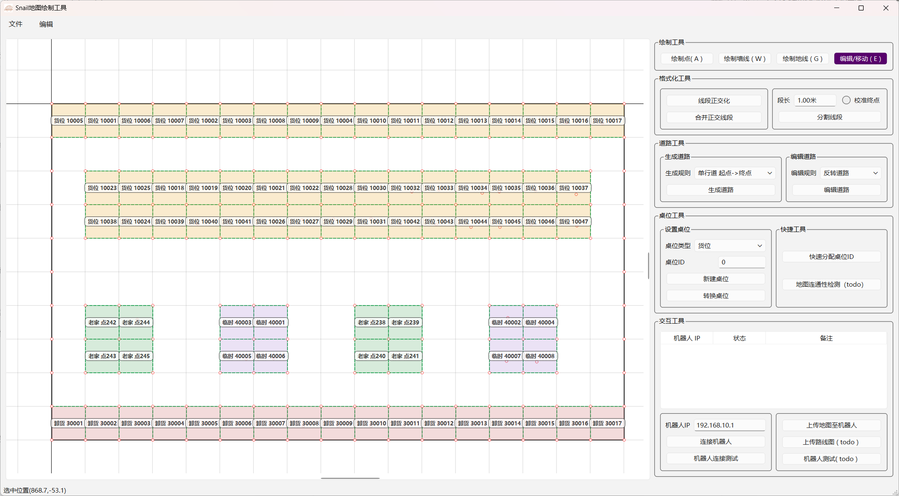

# QTSnailMapDrawer — 仓库机器人地图编辑器

> A Qt-based map editor for warehouse AMR/AGV robots: draw walls, roads and storage slots on a metric canvas, and upload the map to robots over TCP.


**状态**：v0.9.5 · 完成度约 95% · 剩余事项见[路线图](#已知问题与路线图)

## 它解决什么问题

物流机器人在仓库里运货，需要一张**机器可读的地图**：哪里是硬边界不能撞（墙）、哪里可以走（道路）、在哪取货（货位）、在哪卸货（卸货点）、在哪待命（机器人老家）。仓储自动化系统的第一步就是把这张图画出来——本工具就是画这张图的起点工具。

地图产出后**同时下发给机器人本体与机器人调度控制端**：机器人靠它定位导航，控制端靠它做调度——通过设计正向单行道/逆向单行道/双行道/禁行道，可以约束每台机器人的可行走路径，避免对撞、实现交通调度。

**输入**：机器人激光雷达扫描得到的仓库环境——扫描到的墙面记录为墙线，地面标记线记录为地线；也可以人工基于仓库图纸直接绘制。

**输出**：机器人可读的地图文件（`.rou` 格式，GBK 编码），并可通过 TCP 直接下发到机器人并接收确认回执。

## 地图上画的是什么（领域概念）

| 图元 | 业务含义 |
|---|---|
| 墙线 | 激光雷达扫到的**墙面**——机器人的硬边界 |
| 地线 | 激光雷达扫到的**地面标记线**——区域分界/软约束 |
| 道路 | 机器人可行走的路线，四种通行规则（正向/逆向单行、双行、禁行）承载调度语义 |
| 货位 | 机器人**取货**点 |
| 临时货位 | 运送途中的**途经/缓冲**点 |
| 卸货点 | 货物送达的**目的地** |
| 机器人老家 | 机器人**待命/充电**位 |
| 道路点 | 路口/路径节点，机器人路线指令的引用单位 |

一次典型的业务流：机器人从**老家**出发 → 沿**道路**行进（受单行道规则约束，必要时在**临时货位**缓冲让行）→ 到**货位**取货 → 送往**卸货点** → 返回老家。机器人收到的路线指令就是一串位置 ID：`老家 → 路口A → 货位10005 → 路口B → 卸货点30001`。

本工具绘制的，就是承载这条完整链路的**真实仓库地图与机器人路线**。原公司生产系统使用一套 .NET 编辑器维护这张图，本项目用 Qt 从零重写并增强；坐标系约定 100 场景单位 = 1 米。

## 功能特性

**绘制与编辑**
- 链式连线：单击起点后连续落点，Esc/双击链头取消；橡皮筋预览终点实时磁吸
- 智能吸附：光标接近点/线时灰色指示环实时预览吸附目标（所见即所得，绘制在 `drawForeground` 层）
- 穿点分段：连线精确穿过既有图点时自动以其为中间节点分段（浮点容差判定，不依赖精确相等）
- 线上加点：在既有墙线上落点自动分割为两段（撤销感知）
- 图元拖动：拖点线随动；拖线=平移其两个端点；框选组整体平移

**格式化工具（几何算法）**
- 线段正交化：TLS 最小二乘拟合 + 图遍历（BFS 方向连续性分组、交叉口边界切割），近水平/垂直组自动对齐坐标轴，L 型拐角由水平/垂直两组共同约束
- 合并共线：严格共线判定后删除中间点直连两端
- 等长分割 + 终点校准：按给定段长等分，容差内自动挪动端点使总长凑整，保证货位规格一致

**道路与货位（业务逻辑）**
- 道路绘制：四种通行规则可随时转换（单行反转/设双行/设禁行），箭头/禁行标记实时渲染
- 六类桌位（货位/临时/卸货点/机器人老家/道路点/标记点），各自独立配色，围合方块自动探测（四向射线找最近墙线，整格填色），字号随格子尺寸自适应
- 位置 ID 可视化：类型+ID 标签直接标在地图上——控制端下发的路线指令（`位置id→位置id→…`）可以对照地图直接读懂
- 5 位业务 ID 体系（首位编码类型，如货位 10001 系列、卸货点 30001 系列），支持按阅读顺序（从上到下、从左到右）批量分配与逐点转换/补号

**撤销/重做（混合式架构，详见下文）**

**持久化与通信**
- `.rou`/CSV 双向读写，GBK 编码（机器人协议要求），`QSaveFile` 原子写入
- 两段式加载：先全量解析校验、后构建图元，坏文件不污染画布
- TCP 下发：连接机器人 → 上传地图 → 接收确认回执；附带 Python 模拟机器人脚本可本地联调

## 架构亮点

**混合式 Undo** —— 命令模式与快照模式按操作性质分派，共存于同一 `QUndoStack`：
- 纯创建/移动操作走命令式（`AddItemsCommand` / `MoveItemCommand`），规格只存稳定 ID 不存指针
- 结构性操作（线上加点、删除、合并、类型转换）走快照式（`SnapshotCommand`，全量序列化往返）
- 图元 ID 双体系（点/线各一套计数器，随文件往返），身份穿越快照重建而不失效

**数据/视图分层** —— View 只管交互状态（工具、橡皮筋、吸附指示），MainWindow 统一持有图元变更（"修改门"模式：任何可能删除图元的操作先结束进行中的交互），MapScene 承担文档身份（ID 分配、查询、变更信号）

**线的工厂 + 继承体系** —— `MapLineItem` 基类封装几何/注册/拖动，`MapWallItem`/`MapGroundItem`/`MapRoadItem` 只重写视觉钩子；全族共享 `UserType` 标识保证 `qgraphicsitem_cast` 兼容；`LineType` 枚举保留为序列化词汇表（枚举管数据分类，类管行为分类）

**TCP 模块** —— 每机器人一个 `QThread` + `RobotWorker`（moveToThread 模式）；4 字节大端长度前缀封帧 + 接收缓冲解决粘包；心跳 ping/pong 超时检测；断线指数退避重连；跨线程全部经队列信号通信

**装饰子图元** —— 货位方块/标签作为点的 child item：子随父动、删除陪葬、快照重建自动复活，零注册代码；方块几何在 `paint()` 期现场探测（只读场景查询），墙移动时借框架脏区机制自动重算

## 构建

```
依赖：Qt 6.5+（含 Qt5Compat 模块，用于 GBK 编解码）、CMake 3.19+、C++20 编译器

git clone <本仓库>
cmake -B build -DCMAKE_PREFIX_PATH=<Qt安装路径>
cmake --build build
```

## TCP 联调（附带模拟机器人）

```
# 1. 启动模拟机器人（需本机有 192.168.105.10 地址，或改脚本里的 IP）
python robot_sim.py

# 2. 编辑器中输入机器人 IP → 连接机器人 → 上传地图
#    模拟器会打印收到的地图字节数并回复 ack，编辑器表格显示"✔ 地图已确认收到"
```

## 已知问题与路线图

- [ ] **道路拓扑准确性检测 + 货位可达性检测**：校验每条道路与货位在拓扑上连通可达（无孤岛、无违反单行约束的不可达路径），并将检测结果渲染到地图上（红色标记不可达货位/断头路）
- [ ] `RobotManager` 断开时 worker 清理存在轻微泄漏（线程退出后 `deleteLater` 失效，v1.1 改为 `finished` 信号关联删除）
- [ ] 地图连通性检测按钮：已预留，对应上条图算法功能
- [ ] 上传路线：当前为占位协议，待路线编辑功能落地
- [ ] 道路传送带动画渲染（查周围墙生成流动效果）
- [ ] 机器人位置回传实时渲染
- [ ] 机器人格式转换器（内部格式 → 老版 .rou 邻居列表道路表示，防腐层模式）

## 关于

**本项目为个人独立项目，与任何雇主无关，不包含前雇主的代码、数据、文档或商业秘密。**

作者在原公司参与过该机器人系统的地图生成模块（Excel → 地图解析），深知原 .NET 编辑器在实际仓储业务中的痛点（无吸附导致线段歪斜、货位规格不一、无位置可视化）。本项目是一次"带着业务理解的重写"：所有增强功能都来自真实使用场景。
